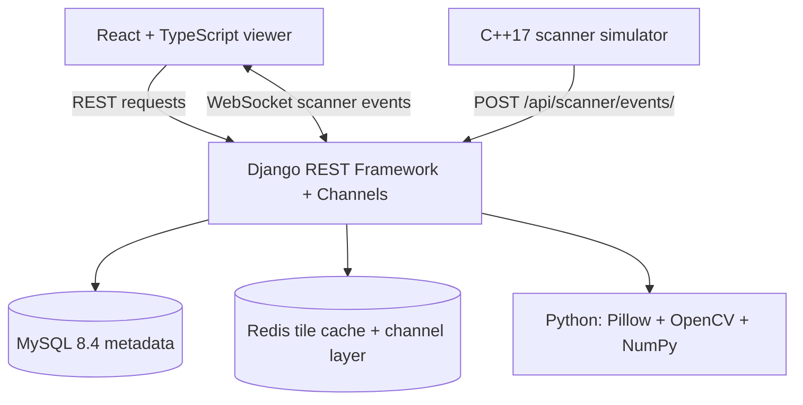

# MicroSight

**Whole-Slide Imaging & AI Analysis Platform**

Educational, non-diagnostic engineering prototype for large microscopy-image visualization, tile streaming, experimental image analysis, and scanner simulation.

React · Django · MySQL · Redis · OpenCV · C++17 · Docker

> This project is educational and non-diagnostic. AI/image-analysis outputs are experimental and are not intended for medical diagnosis.

## Overview

MicroSight demonstrates the core engineering building blocks of a whole-slide imaging workflow. It accepts common microscopy-image formats, generates a disk-backed image pyramid, streams viewport-derived tiles to a React viewer, and exposes experimental OpenCV-based visual heuristics. A deterministic C++ scanner simulator reports scan events through Django and Django Channels to the browser over WebSockets.

## Public demo

After the deployment workflow runs, the device-friendly interactive demo is available at **https://sagarwal-bit.github.io/microsight/**. It uses a safe synthetic slide and runs entirely in the browser: pan, zoom, inspect sample overlays, add a note, and run experimental analysis. It needs no account, download, API server, or medical data. For uploads and the full scanner/API workflow, run the Docker stack locally.

## Key features

- Upload PNG, JPEG, TIFF, or WebP microscopy images.
- Generate 256 px multi-resolution image pyramids and fetch only visible tiles.
- Pan and zoom a React + TypeScript slide viewer.
- Run experimental OpenCV analysis and retrieve regions, objects, heatmaps, and quality heuristics.
- Create and manage slide annotations through REST endpoints.
- Simulate scanner movement, focus/camera failures, retries, and progress with C++17.
- Broadcast scanner events through Django Channels WebSockets.
- Run the complete development stack with Docker Compose, MySQL 8.4, and Redis.

## Architecture



## Tech stack

| Area | Technology |
| --- | --- |
| Frontend | React, TypeScript, Vite |
| API and real-time | Django, Django REST Framework, Django Channels |
| Data services | MySQL 8.4, Redis |
| Image processing | Python, OpenCV, Pillow, NumPy |
| Scanner simulation | C++17, CMake |
| Local orchestration | Docker Compose |

## Screenshots

The application is runnable locally; screenshots are intentionally not fabricated. See [screenshot capture instructions](docs/screenshots/README.md) for adding dashboard, viewer, analysis, and scanner-monitoring screenshots after running the stack.

## Quick start (Ubuntu/Linux)

Prerequisites: Docker Engine with the Docker Compose plugin, plus Python 3 if you want to generate the demo image on the host.

```bash
git clone <PUBLIC_GITHUB_URL>
cd microsight

cp .env.example .env
docker compose --env-file .env up --build
```

Open [http://localhost:4200](http://localhost:4200). The API health check is at [http://localhost:8000/api/health/](http://localhost:8000/api/health/).

In another terminal, generate a safe synthetic demo image:

```bash
python3 scripts/generate_demo_image.py
```

The image is written to `work/demo-microscopy.png`. The `work/` directory is generated locally and is not committed.

To stop the stack:

```bash
docker compose down
```

## Demo workflow

1. Start Docker Compose and generate the synthetic demo image.
2. Open the React frontend at `http://localhost:4200`.
3. Upload `work/demo-microscopy.png`.
4. Select the uploaded slide and pan or zoom in the viewer.
5. Observe viewport-derived tile requests as the viewer streams the image pyramid.
6. Select **Run experimental analysis**.
7. Request the analysis heatmap or detected objects through the API endpoints below.
8. Add annotations through the annotations API.
9. Run the scanner simulator in a second terminal:

   ```bash
   docker compose exec scanner microsight_scanner --demo
   ```

10. Demonstrate deterministic retry behavior with `--fail-focus` or `--fail-camera`.
11. Observe scanner progress in the dashboard through WebSocket updates.

## API overview

| Endpoint | Purpose |
| --- | --- |
| `POST/GET /api/slides/` | Upload or list slides |
| `GET /api/slides/{id}/tiles/{level}/{x}/{y}/` | Fetch a JPEG tile |
| `POST /api/slides/{id}/analyze/` | Run experimental analysis |
| `GET /api/slides/{id}/heatmap/` | Retrieve heatmap data |
| `GET /api/slides/{id}/objects/` | Retrieve detected visual objects |
| `POST /api/scanner/events/` | Ingest scanner events |
| `GET /api/scanner/jobs/` | List scanner jobs |
| `GET /api/health/` | Check API dependencies |
| `GET /api/metrics/` | Read viewer/cache metrics |

See [docs/api.md](docs/api.md) for the compact endpoint reference.

## Scanner simulator

The scanner simulator is a deterministic C++17 command-line program. It models stage movement, autofocus, capture, retries, and callback delivery. When `BACKEND_URL` is present, it posts events to the Django scanner API.

```bash
cmake -S scanner-simulator -B scanner-simulator/build
cmake --build scanner-simulator/build
ctest --test-dir scanner-simulator/build --output-on-failure

./scanner-simulator/build/microsight_scanner --demo
./scanner-simulator/build/microsight_scanner --fail-focus
```

## Testing and validation

```bash
# Backend syntax check
python3 -m compileall -q backend scripts

# Frontend production build
cd frontend && npm install && npm run build && cd ..

# C++ scanner tests
cmake -S scanner-simulator -B scanner-simulator/build
cmake --build scanner-simulator/build
ctest --test-dir scanner-simulator/build --output-on-failure

# Docker configuration and backend tests
docker compose --env-file .env config
docker compose --env-file .env run --rm backend python manage.py test
```

For the Docker-based test command, the database account needs permission to create Django's temporary test database. In this local demo, use a database administrator account only for test execution if needed; keep application credentials least-privileged.

## Benchmark

After the backend is running:

```bash
python3 scripts/benchmark_tiles.py
```

## Project structure

```text
backend/             Django API, models, services, and tests
frontend/            React + TypeScript viewer
scanner-simulator/   C++17 scanner simulator and CTest coverage
scripts/             Demo-image generator and tile benchmark
docs/                Architecture and implementation notes
docker-compose.yml   MySQL, Redis, API, frontend, and scanner services
```

## Limitations

- This is an educational, non-diagnostic prototype; it is not a medical device.
- Image-analysis outputs are experimental visual heuristics, not clinical results.
- Pyramid generation and analysis are synchronous for predictable local demos.
- Media is stored locally in the Compose deployment; production systems should use object storage.
- Scanner callback delivery is best-effort and logs failures rather than blocking scans.

## Future improvements

- Move long-running processing to worker queues.
- Add object storage and signed media URLs.
- Add authentication, authorization, and audit logging.
- Add observability, performance tracing, and rate-aware background processing.
- Expand API schemas and automated end-to-end browser tests.
